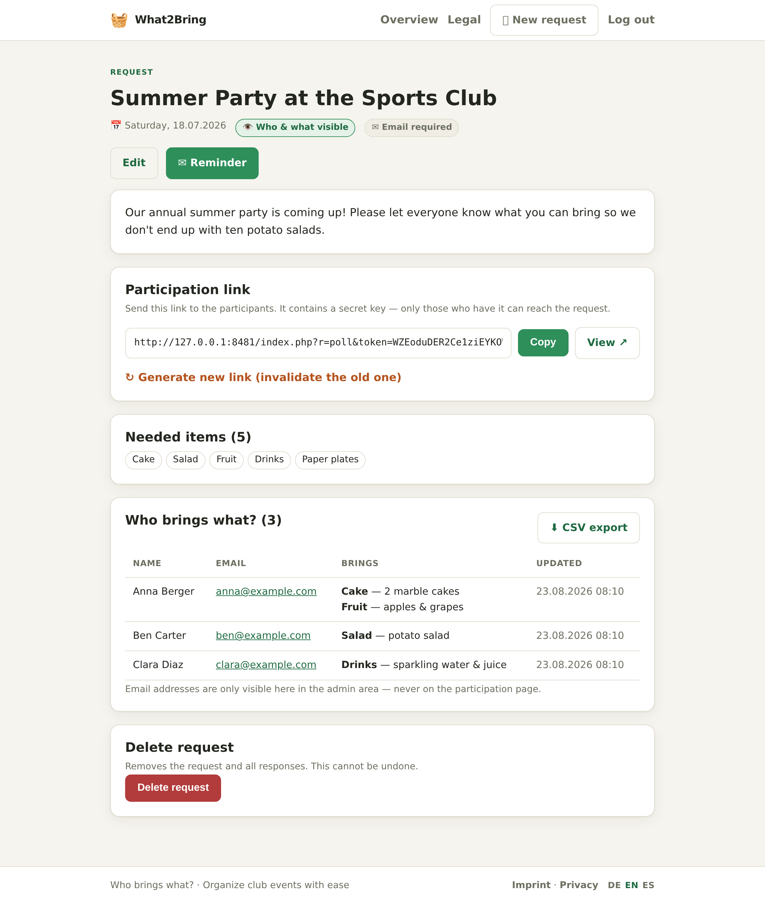
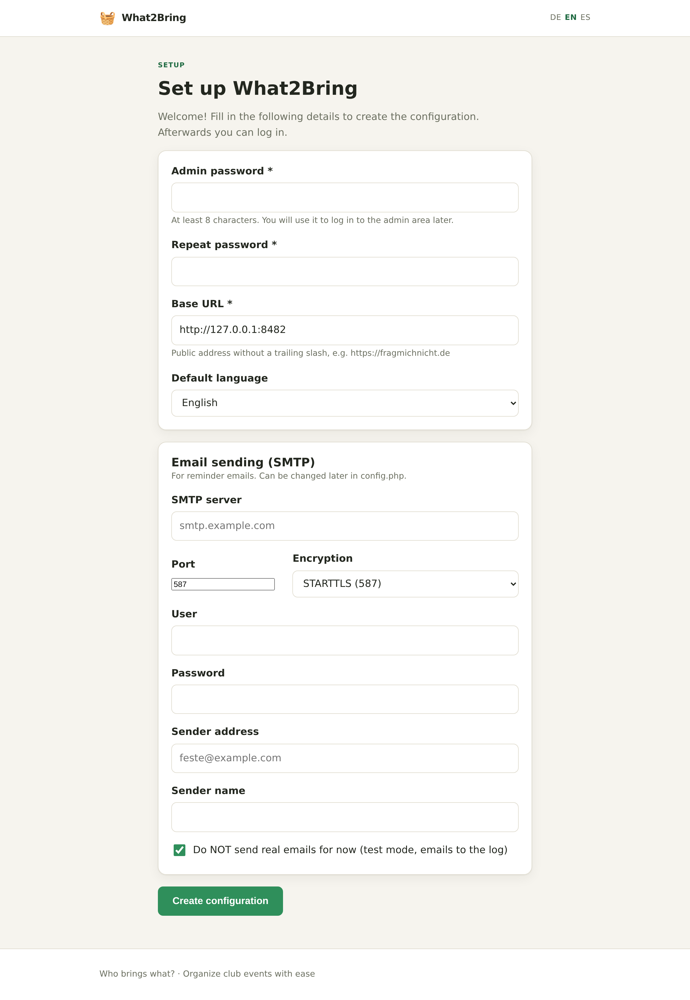
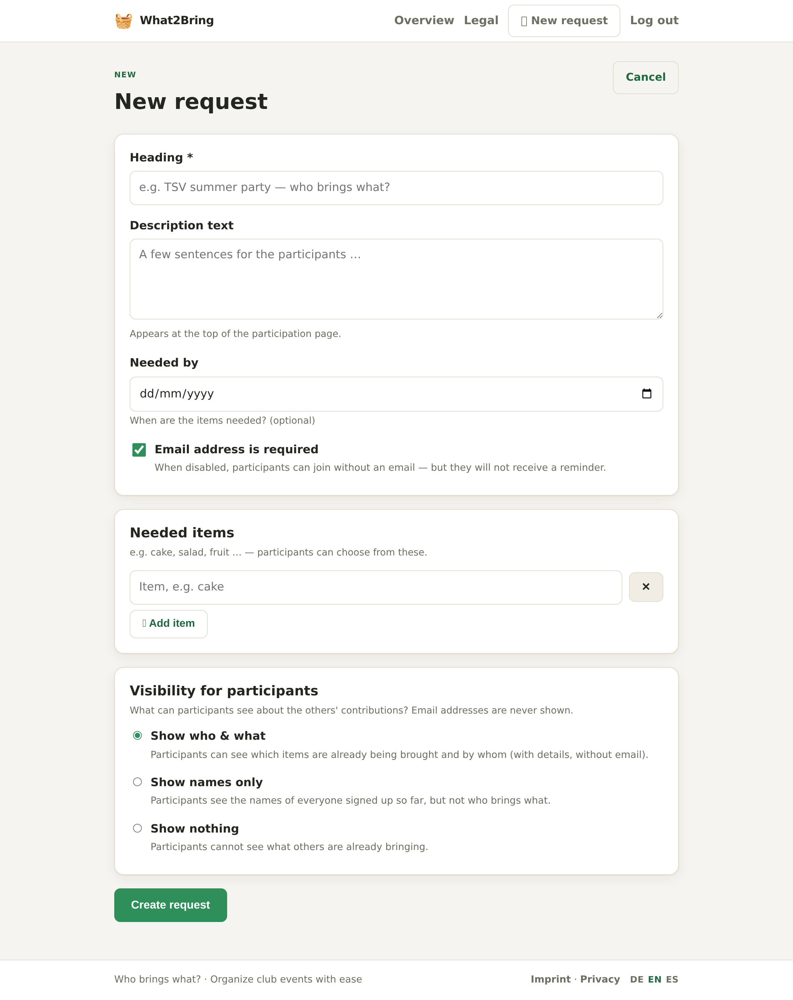
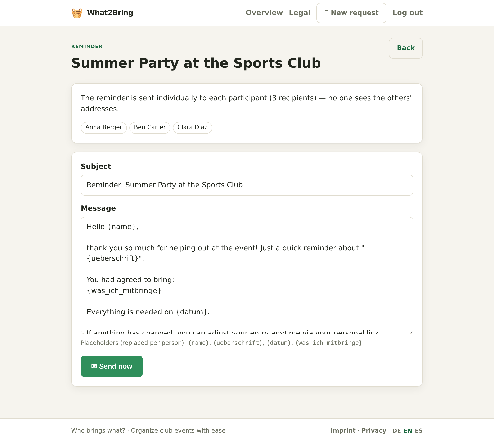
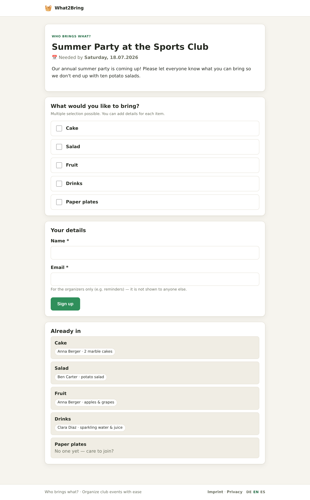
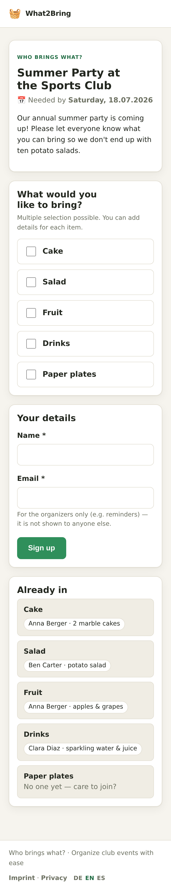
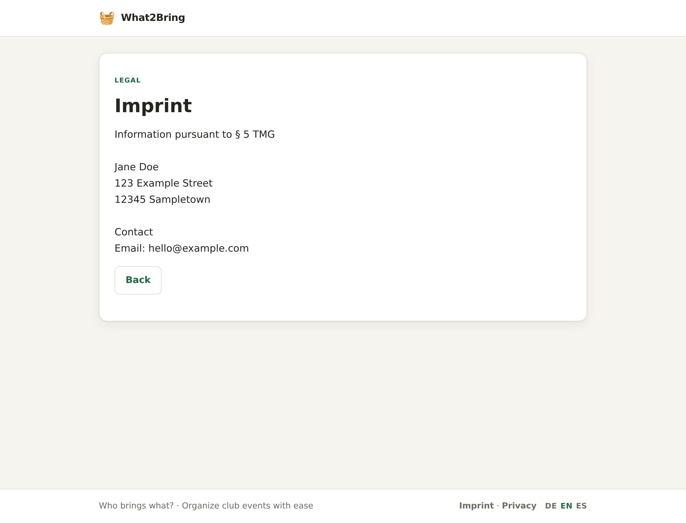

# 🧺 What2Bring

**English** · [Deutsch (Handbuch)](docs/HANDBUCH.md) · [Handbook](docs/HANDBOOK.md) · [Changelog](CHANGELOG.md)

[](https://github.com/Jo-Highness/what2bring/actions/workflows/ci.yml)


**“Who brings what?”** — a small, self‑hosted web app for organising club parties, potlucks and team events.
An organiser creates a *request* listing the things that are needed (cake, salad, drinks …) and shares **one secret
link**. People open the link, tick what they’ll bring, add a detail, and leave their name. No accounts, no app.

**PHP 8.1+ & SQLite · no Composer · no build step · runs on cheap shared hosting or as a hardened Docker container.**
Available in **🇩🇪 German · 🇬🇧 English · 🇪🇸 Spanish**.



## Quick start (Docker)
```bash
git clone https://github.com/Jo-Highness/what2bring.git && cd what2bring
docker compose up -d --build
docker compose logs what2bring          # copy the setup token
```
1. Open **http://localhost:8470** — the setup wizard appears.
2. Paste the **setup token** from the log, choose an admin password and the base URL, click *Create configuration*.
3. Log in, create your first request and share its link.

The container is **production-capable**: it runs as `www-data` on port 8080 with a read-only root filesystem,
`cap_drop: ALL` and `no-new-privileges`; all data (SQLite, config, mail log) lives in the `/data` volume. For real use,
put an HTTPS reverse proxy in front and set `W2B_TRUSTED_PROXIES` — see
[Handbook § 13](docs/HANDBOOK.md#13-reverse-proxy--https). Using a bind mount (`./data:/data`)? Run
`sudo chown -R 33:33 ./data` once.

## Quick start (shared hosting / own server)
1. **Requirements:** PHP 8.1+ with `pdo_sqlite` and `mbstring`.
2. **Upload the code** and point the domain’s document root at **`public/`** (everything sensitive then sits above
   the web root). Apache without that option: the top‑level `.htaccess` blocks `inc/`, `data/`, `templates/`,
   `config.php` … instead. nginx: document root **must** be `public/` — see
   [`docs/examples/nginx-php-fpm.conf`](docs/examples/nginx-php-fpm.conf).
3. **Make `data/` writable** for the web server.
4. **Open the site.** The setup wizard asks for the **setup token** — it is in the PHP error log and in
   `data/.setup_token` (download it via FTP/SFTP). The wizard writes `config.php` and locks itself.

> **Without the wizard:** copy `config.php.example` to `config.php` (one level **above** `public/`) and fill it in,
> or configure everything through `W2B_*` environment variables — see the
> [configuration reference](docs/HANDBOOK.md#12-configuration-reference).

**Try it locally:** `W2B_SETUP_ALLOW_LOCAL=1 php -S 127.0.0.1:8080 -t public` (no setup token needed on 127.0.0.1).

## Features
- **Requests** with a heading, description, “needed by” date and a dynamic list of items.
- **Secret share link** per request (rotatable — the old link stops working); search engines stay out (`noindex`).
- **Participant page, no login:** multi‑select items, a detail per item, name + email. Each entry gets a **personal
  edit link** — participants can change or withdraw their entry, nobody else can.
- **Per‑request email toggle** — make the email address required or optional.
- **Visibility per request:** show *who & what* · *names only* · *nothing* — **email addresses are never shown publicly.**
- **Reminder emails** with placeholders, sent **individually** (one recipient per message, no CC/BCC).
- **CSV export** of all responses (Excel‑friendly).
- **Imprint & privacy policy** editable in the admin area (with templates to fill in).
- **Data protection:** delete single entries, optional automatic deletion of old requests, redacted dry‑run mail log.
- **Operations:** web installer with setup token, configuration via file or environment variables, `bin/backup.php`
  (WAL‑safe snapshot), health endpoint, versioned DB migrations.

## Screenshots
| Setup wizard | New request | Reminder |
|---|---|---|
|  |  |  |

| Participant page | On mobile | Imprint |
|---|---|---|
|  |  |  |

## 📖 Documentation
- **[English handbook](docs/HANDBOOK.md)** · **[Handbuch (Deutsch)](docs/HANDBUCH.md)** — installation (Docker and
  shared hosting), using the app, configuration reference, reverse proxy & HTTPS, updating, backup & restore,
  data protection, troubleshooting.
- [Changelog](CHANGELOG.md) · [Security policy](SECURITY.md) · [Requirements (German)](docs/requirements.md)

## Security & privacy
- Emails **never** appear on public pages (structurally separated in the data model).
- The installer only accepts a **setup token** from the server log, so nobody can claim a fresh instance.
- Admin login stores only a password hash; failures are **throttled per IP and account, persisted in the database**;
  sessions use strict mode and expire after 30 minutes of inactivity.
- Secret links use ≥128‑bit tokens; entries can only be edited with their own 256‑bit edit token.
- CSRF tokens on every form; prepared statements; output escaping; **CSP without inline scripts**; HSTS on HTTPS;
  `X-Forwarded-*` only from configured proxies; input length limits and rate limiting on public forms.
- IP addresses used for throttling are stored only as a keyed hash and deleted after 24 hours.
- The legal‑text templates are a **starting draft, not legal advice** — review before going live. If you send real
  mail, conclude a data processing agreement (DPA / AVV) with your SMTP provider.

Found a vulnerability? Please report it privately — see [SECURITY.md](SECURITY.md).

## Development
```bash
php tests/security_test.php    # unit / regression tests
php tests/http_test.php        # end-to-end tests against php -S
```
CI runs both on PHP 8.1–8.4, plus hadolint, shellcheck and a Docker smoke test.

## License
MIT — see [LICENSE](LICENSE).
