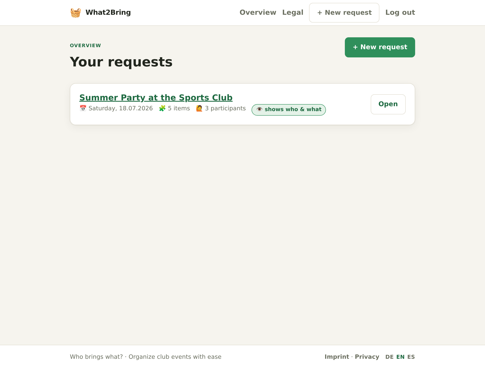
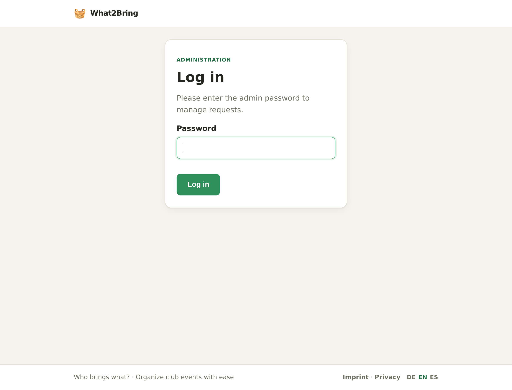
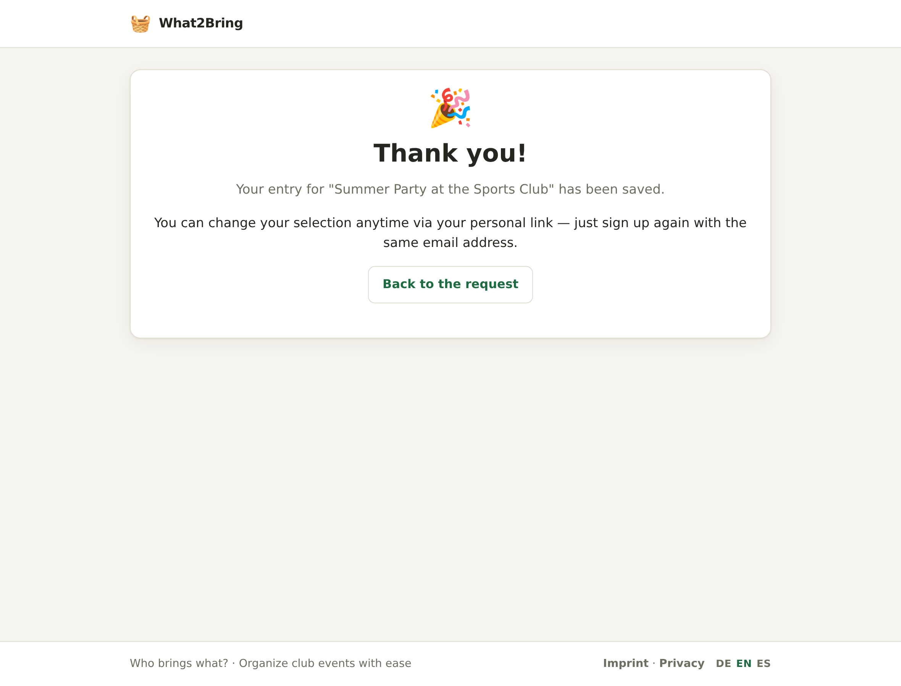
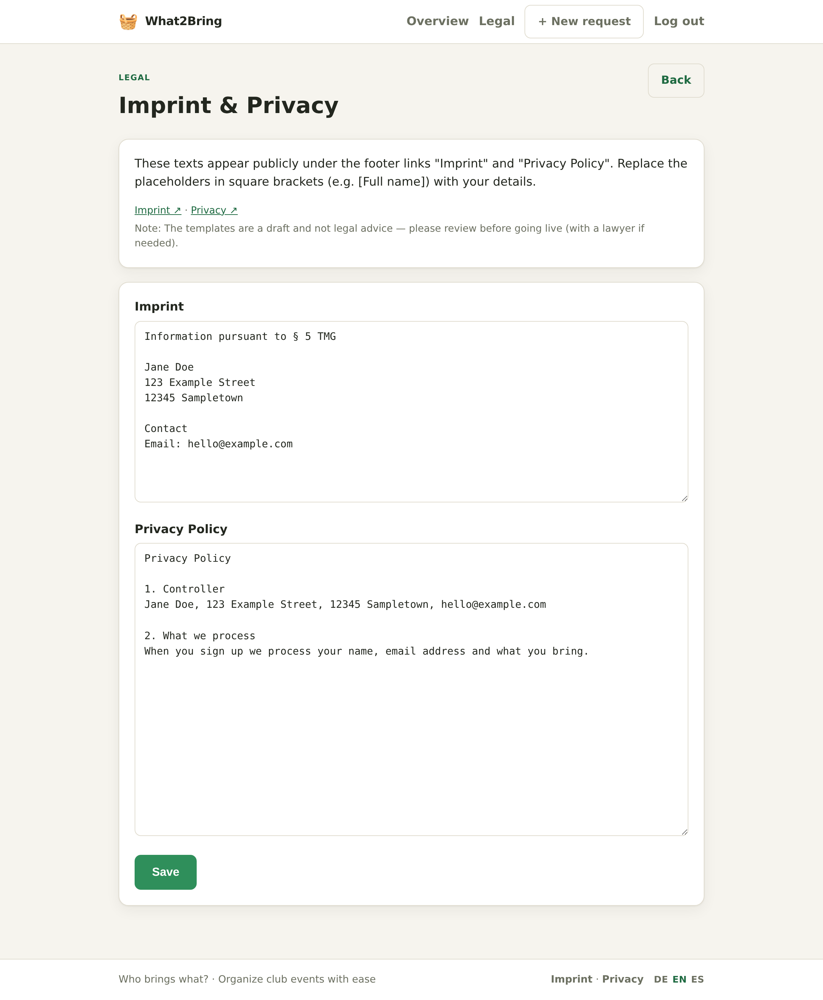

# What2Bring — Handbook

**English** · [Deutsch](HANDBUCH.md) · [README](../README.md)

**What2Bring** is a small, self‑hosted web app for the classic club‑party question: **“Who brings what?”**
An organiser (admin) creates a *request* listing the things that are needed — cake, salad, fruit, drinks —
and shares one **secret link**. Participants open that link, tick what they will bring, add a detail or two,
and leave their name (email optional per request). No accounts, no app, works on cheap shared hosting.

> 🌐 Available in **German, English and Spanish** · 🔒 privacy‑first (emails never shown publicly) · 🧩 no build step, no Composer

- **Languages:** switch any time via the footer (DE · EN · ES); set the default during setup.
- **Screens in this handbook show the English UI.** The other languages look identical with translated text.

| | |
|---|---|
|  |  |

## Contents
1. [Requirements](#1-requirements)
2. [Installation](#2-installation)
   - [2.1 Docker (recommended)](#21-docker-recommended)
   - [2.2 Shared hosting / own web server](#22-shared-hosting--own-web-server)
   - [2.3 The setup wizard](#23-the-setup-wizard)
3. [First login](#3-first-login)
4. [The dashboard](#4-the-dashboard)
5. [Creating a request](#5-creating-a-request)
6. [Managing a request & sharing the link](#6-managing-a-request--sharing-the-link)
7. [Sending reminders](#7-sending-reminders)
8. [The participant page](#8-the-participant-page)
9. [Imprint & privacy policy](#9-imprint--privacy-policy)
10. [Languages](#10-languages)
11. [Security & privacy](#11-security--privacy)
12. [Configuration reference](#12-configuration-reference)
13. [Reverse proxy & HTTPS](#13-reverse-proxy--https)
14. [Deploying to shared hosting (e.g. Strato)](#14-deploying-to-shared-hosting-eg-strato)
15. [Updating](#15-updating)
16. [Backup & restore](#16-backup--restore)
17. [Troubleshooting](#17-troubleshooting)

---

## 1. Requirements
- **PHP 8.1+** with the **`pdo_sqlite`** and **`mbstring`** extensions (included in the Docker image and enabled on
  most shared hosts). On an older PHP, What2Bring shows a clear message instead of starting.
- **Either** Docker (with Compose) **or** a web server that can serve a folder: Apache (`.htaccess` included) or
  nginx + PHP-FPM (example config included). Ideally the domain’s document root points at the app’s **`public/`** folder.
- **No** database server, **no** Composer, **no** build step. Email sending uses a tiny built‑in SMTP client.
- For production: **HTTPS** (e.g. via a reverse proxy or your hoster).

## 2. Installation

### 2.1 Docker (recommended)
The image is production-capable: it runs as the unprivileged `www-data` user on port 8080 with a read-only root
filesystem, all capabilities dropped and `no-new-privileges`. All state (SQLite database, `config.php`, mail log)
lives in the `/data` volume.

```bash
git clone https://github.com/Jo-Highness/what2bring.git && cd what2bring
docker compose up -d --build
docker compose logs what2bring        # shows the setup token
```

1. Open **http://localhost:8470** (or `http://<server>:8470`). The setup wizard appears.
2. Copy the **setup token** from `docker compose logs what2bring` (block *“enter this setup token”*) into the
   first field. You can also read it with `docker compose exec what2bring cat /data/.setup_token`, or choose it
   yourself beforehand with `W2B_SETUP_TOKEN` in `docker-compose.yml`.
3. Fill in the rest (see [2.3](#23-the-setup-wizard)) and click **Create configuration** — it is written to
   `/data/config.php` inside the volume.
4. Log in and create your first request. For real use, put HTTPS in front (see
   [13. Reverse proxy & HTTPS](#13-reverse-proxy--https)).

**Bind mount instead of the named volume?** Replace `w2b-data:/data` with `./data:/data`. The directory must be
writable for UID 33 (`www-data`): run `sudo chown -R 33:33 ./data` once. If it is not, the container stops with
exactly this hint. Alternatively start the container as root (`user: "0:0"` plus `cap_add: [CHOWN, SETUID, SETGID]`);
the entrypoint then fixes the ownership and drops to `www-data` itself.

**Configuration without the wizard:** set `W2B_ADMIN_PASSWORD_HASH` and `W2B_APP_PEPPER` (plus `W2B_BASE_URL`,
SMTP …) as environment variables — see [12. Configuration reference](#12-configuration-reference). In
`docker-compose.yml` every `$` of the password hash must be written as `$$`. Secrets can also come from files
(`W2B_SMTP_PASS_FILE=/run/secrets/…`).

### 2.2 Shared hosting / own web server
1. **Get the code** — download a release archive or clone the repository, and upload it to your host.
2. **Document root** — point your domain at the **`public/`** directory. Everything sensitive (`config.php`, the
   database in `data/`, `inc/`, `templates/`) then lives *above* the web root. If you cannot move the document root
   (Apache only), the bundled top‑level `.htaccess` blocks direct access to those paths instead. With **nginx** there
   is no `.htaccess` — the document root **must** be `public/`; use
   [`docs/examples/nginx-php-fpm.conf`](examples/nginx-php-fpm.conf).
3. **Make `data/` writable** for the web server (the database, the mail log and the setup token are created there).
4. **Get the setup token:** it is written to the PHP error log on the first visit and stored in
   `data/.setup_token` — download that file via FTP/SFTP if you cannot read the log. Alternatively run
   `php bin/setup-token.php` on the server.
5. **Open the site in your browser** and complete the wizard.

For a quick local test: `W2B_SETUP_ALLOW_LOCAL=1 php -S 127.0.0.1:8080 -t public` — on `127.0.0.1` the wizard then
does not ask for the token. Never set this variable behind a reverse proxy on the same machine.

### 2.3 The setup wizard
While the app is not configured (no `config.php` and no configuration via environment variables), every page shows
the **setup wizard**:


Fill in:
- **Setup token** — proves that you operate this server (see above). Without it nothing is saved, so nobody can
  claim a freshly deployed instance before you do.
- **Admin password** (min. 10 characters) — you’ll use it to log in.
- **Base URL** — the public address without a trailing slash, e.g. `https://events.example.org`. Used to build the
  shareable links.
- **Trusted reverse proxies** (optional) — see [13](#13-reverse-proxy--https).
- **Default language** — DE / EN / ES.
- **SMTP** (optional now, changeable later) — server, port + encryption (STARTTLS/587 or SSL/465), user,
  password, sender address and name.
- **“Do NOT send real emails for now”** — leave ticked to start in a safe *dry‑run* (reminders go to a log file
  instead of being sent). Untick once your SMTP details are correct.

Clicking **Create configuration** writes `config.php` (with a freshly generated password hash and secret
*pepper*), deletes the setup token and the installer **locks itself** — it never runs again while the configuration exists.

> **Manual alternative:** copy `config.php.example` to `config.php` (one level above `public/`, or to the path in
> `W2B_CONFIG`) and fill it in by hand. Generate the password hash with
> `php -r "echo password_hash('YOUR-PW', PASSWORD_DEFAULT);"` and the pepper with `php -r "echo bin2hex(random_bytes(32));"`.

## 3. First login
Go to `…/index.php?r=admin.login` and enter your admin password.



## 4. The dashboard
After logging in you land on **Overview** — the list of all your requests with their date, item count, number of
participants and a visibility badge. Use **＋ New request** to create one.


## 5. Creating a request


- **Heading** — the title participants see (e.g. *“Summer Party at the Sports Club”*).
- **Description** — a few friendly sentences (optional).
- **Needed by** — the date the things are needed (optional).
- **Email address is required** — a per‑request switch. When **off**, people can join *without* an email address
  (they simply won’t receive reminders).
- **Needed items** — add as many as you like (Cake, Salad, Fruit …). Participants pick from these.
- **Visibility for participants** — what people see about *others’* entries. Email addresses are **never** shown:
  - **Show who & what** — names + what they bring (with details).
  - **Show names only** — just who is participating.
  - **Show nothing** — participants don’t see others’ entries.

## 6. Managing a request & sharing the link


- **Participation link** — the secret URL to send out. It contains a random key; only people who have the link can
  reach the request (search engines are kept out via `noindex`). **Copy** it, or **View** it in a new tab.
- **Generate new link** — rotates the key. The **old link stops working** immediately (useful if a link leaked).
- **Needed items** — a quick overview of the defined items.
- **Who brings what** — every response, **including the email address** (visible to you only, never publicly).
  Entries made without an email show “— (no email)”.
- **CSV export** — download all responses (Name, Email, Brings, Updated) as a semicolon‑separated, UTF‑8 file that
  opens cleanly in Excel.
- **Delete a single entry** — the ✕ next to an entry removes it (e.g. when someone asks for their data to be deleted).
- **Delete request** — removes the request and all its responses (irreversible).

## 7. Sending reminders


Write a subject and message, then send. Each participant receives an **individual** email (one recipient per
message — nobody sees anyone else’s address). These placeholders are replaced per person:

| Placeholder | Becomes |
|---|---|
| `{name}` | the participant’s name |
| `{ueberschrift}` | the request heading |
| `{datum}` | the “needed by” date |
| `{was_ich_mitbringe}` | what that person signed up to bring |

Only participants who provided an email are contacted. The message box is pre‑filled with a template in the current
language — edit it freely before sending.

## 8. The participant page
This is what people see when they open the secret link. They tick the items they’ll bring, optionally add a detail
per item, and enter their name (and email, if required).

| Desktop | Mobile |
|---|---|
|  |  |

Depending on the request’s visibility they also see a **“Who’s in”** section (names, or names + items). After
submitting they get a confirmation with their **personal edit link**:



**Changing or withdrawing an entry:** every entry has its own secret edit token. The browser that created the entry
remembers it (cookie), so opening the request link again shows the person’s own entry, ready to change — or to
delete via **Delete my entry**. On other devices people use the personal link from the thanks page (or from the
optional confirmation mail, `confirmation_mail`). Submitting the **same email address without** that token is
rejected with a clear message — nobody can overwrite someone else’s entry just by knowing their address. If someone
has lost their link, delete the old entry in the admin view (✕ next to the entry) and let them sign up again.

To protect against spam there are length limits (name 100, email 254, detail 200 characters) and a limit of 20
submissions per IP address and request within 10 minutes (`submit_rate_limit`).

## 9. Imprint & privacy policy
If you run the site under your own domain you typically need an **Imprint** and a **Privacy policy**. What2Bring
makes both **editable in the admin area** (menu **Legal**) — no code changes, stored in the database. Each field is
pre‑filled with a template containing `[placeholders in brackets]` for you to replace.



The texts are published publicly and linked in the footer of every page:


> ⚠️ The templates are a **starting draft, not legal advice** — review them (and, if in doubt, have them checked)
> before going live.

## 10. Languages
What2Bring ships in **German, English and Spanish**. Visitors switch language with the **DE · EN · ES** links in
the footer; the choice is remembered for their session. New visitors get the language from their browser, falling
back to the **default language** you set during setup (`default_lang` in `config.php`). Reminder‑email templates and
the legal‑text templates are localised too.

## 11. Security & privacy
- **Emails never leak publicly.** Plaintext addresses live in a *separate* table that the public code path never
  reads — so a participant page structurally cannot display someone’s email. (Only the holder of an entry’s edit
  token sees their *own* address, to edit it.)
- **Secret links** use ≥128‑bit random tokens, are `noindex`, and can be rotated. Edit tokens are 256‑bit and stored
  only as a hash.
- **Installer protection:** setup token required (see [2](#2-installation)).
- **Admin login** stores only a password *hash*. Failed attempts are counted in the database per IP (lockout from the
  5th failure, growing up to 15 minutes) and for the account as a whole (60 s delay after 50 failures in 15 minutes),
  so clearing cookies does not help an attacker. Sessions use strict mode, a new ID after login and end after
  **30 minutes of inactivity** (`admin_idle_timeout`).
- **CSRF tokens** protect every form; all database access uses prepared statements; all output is HTML‑escaped.
- **Security headers:** Content-Security-Policy without inline scripts (`script-src 'self'`), HSTS on HTTPS,
  `X-Frame-Options: DENY`, `nosniff`, `Referrer-Policy: no-referrer`, `noindex`.
- Reminders are sent **one recipient at a time** (no CC/BCC), with mail headers hardened against injection; CSV
  exports are protected against formula injection.

### Data protection (GDPR)
- **What is stored:** per entry the name, optionally the email address, the chosen items/details and timestamps.
  For throttling, IP addresses are stored only as a keyed hash (HMAC) and deleted after 24 hours. No tracking, no
  external assets.
- **Deleting data:** delete a whole request (incl. all entries) or a single entry in the admin view; participants can
  delete their own entry. Enable automatic deletion with `purge_after_days` (e.g. `90`): requests are removed that
  many days after their date (or creation, if they have no date) — checked when the dashboard is opened, or
  daily via `php bin/purge.php` (cron, see [`docs/examples/crontab.example`](examples/crontab.example)).
- **Dry-run mail log:** in dry-run mode reminders are written to `mail.log` next to the database. By default the
  recipient address is masked (`mail_log` = `redacted`); `full` logs everything (personal data!), `off` logs nothing.
  Delete or rotate the file regularly — see [`docs/examples/logrotate-what2bring`](examples/logrotate-what2bring).
- **SMTP provider:** when you send real reminders, your mail provider processes the recipients’ addresses on your
  behalf. Conclude a **data processing agreement** (Art. 28 GDPR, German: *AVV*) with the provider and mention it in
  your privacy policy.
- Backups contain personal data too — store them protected and delete old ones.

## 12. Configuration reference
Settings come from `config.php` (written by the wizard; see `config.php.example`) and/or environment variables.
**Environment variables win.** For every variable, `NAME_FILE` may point to a file containing the value (Docker secrets).

| config.php key | Environment variable | Default | Meaning |
|---|---|---|---|
| — | `W2B_CONFIG` | `<app>/config.php` (Docker: `/data/config.php`) | Location of the config file |
| — | `W2B_DATA_DIR` | `<app>/data` (Docker: `/data`) | Database, mail log, setup token |
| — | `W2B_SETUP_TOKEN` | generated | Fixed setup token for the wizard |
| — | `W2B_SETUP_ALLOW_LOCAL` | off | Wizard without token on 127.0.0.1/::1 |
| `admin_password_hash` | `W2B_ADMIN_PASSWORD_HASH` | — | `password_hash()` of the admin password |
| `app_pepper` | `W2B_APP_PEPPER` | — | Secret key (64 hex chars); keep it stable |
| `base_url` | `W2B_BASE_URL` | — | Public URL without trailing slash |
| `default_lang` | `W2B_DEFAULT_LANG` | `de` | `de`, `en` or `es` |
| `db_file` | `W2B_DB_FILE` | `<data dir>/what2bring.sqlite` | SQLite file (outside the document root!) |
| `mail_dry_run` | `W2B_MAIL_DRY_RUN` | `true` | Log reminders instead of sending them |
| `mail_log` | `W2B_MAIL_LOG` | `redacted` | Dry-run log: `redacted`, `full`, `off` |
| `trusted_proxies` | `W2B_TRUSTED_PROXIES` | none | IPs/CIDRs allowed to set `X-Forwarded-*` (comma-separated in env) |
| `hsts` | `W2B_HSTS` | `true` | Send HSTS on HTTPS requests |
| `admin_idle_timeout` | `W2B_ADMIN_IDLE_TIMEOUT` | `1800` | Seconds until an idle admin is logged out |
| `purge_after_days` | `W2B_PURGE_AFTER_DAYS` | `0` (off) | Delete requests N days after their date |
| `submit_rate_limit` | `W2B_SUBMIT_RATE_LIMIT` | `20` | Submissions per IP and request per 10 min (0 = unlimited) |
| `confirmation_mail` | `W2B_CONFIRMATION_MAIL` | `false` | Mail participants their edit link |
| `smtp.host` / `port` / `secure` | `W2B_SMTP_HOST` / `_PORT` / `_SECURE` | — / `587` / `starttls` | `secure`: `starttls`, `ssl` or `none` |
| `smtp.user` / `pass` | `W2B_SMTP_USER` / `W2B_SMTP_PASS` | — | SMTP login |
| `smtp.from_email` / `from_name` | `W2B_SMTP_FROM_EMAIL` / `_FROM_NAME` | — | Sender |
| `smtp.verify_tls` | `W2B_SMTP_VERIFY_TLS` | `true` | Verify the SMTP server certificate |

## 13. Reverse proxy & HTTPS
Run What2Bring behind HTTPS in production — the admin password, the secret links and personal data travel over
the connection. The usual setup is a reverse proxy (nginx, Caddy, Traefik, Apache) that terminates TLS and forwards
to the container on `127.0.0.1:8470`.

- **Tell What2Bring which proxy to trust.** Only then are `X-Forwarded-Proto` (→ secure cookies, HSTS) and
  `X-Forwarded-For` (→ correct client IP for throttling) honoured: set `trusted_proxies` / `W2B_TRUSTED_PROXIES` to the
  address the app sees for the proxy (Docker host: usually the bridge gateway such as `172.17.0.1`, or `172.16.0.0/12`).
  Headers from anyone else are ignored, so clients cannot spoof them.
- The proxy must **overwrite** `X-Forwarded-For` with the client address (not append client-supplied values) and set
  `X-Forwarded-Proto`.
- Set the **base URL** to the `https://` address.
- Publish the container port only on localhost (`"127.0.0.1:8470:8080"` in `docker-compose.yml`).

Example for nginx: [`docs/examples/nginx-reverse-proxy.conf`](examples/nginx-reverse-proxy.conf):

```nginx
location / {
    proxy_pass http://127.0.0.1:8470;
    proxy_set_header Host              $host;
    proxy_set_header X-Forwarded-For   $remote_addr;
    proxy_set_header X-Forwarded-Proto $scheme;
}
```

Without a container, nginx + PHP-FPM serves the app directly — document root `public/`, deny everything else:
[`docs/examples/nginx-php-fpm.conf`](examples/nginx-php-fpm.conf).

## 14. Deploying to shared hosting (e.g. Strato)
- Prefer pointing the domain’s **document root at `public/`**. If that isn’t possible, the bundled top‑level
  `.htaccess` denies web access to `inc/`, `data/`, `templates/`, `bin/`, `config.php` and `schema.sql`.
- `config.php` and the `data/` directory must sit **above** the document root (or be `.htaccess`‑denied).
- Routing is **query‑based** (`index.php?r=…`), so `mod_rewrite` is **not** required.
- Make `data/` **writable** by the web server — the SQLite database is created automatically on first use.
- Select **PHP 8.1 or newer** in the hosting control panel.
- Enable HTTPS (most hosters offer free Let’s Encrypt certificates) and use the `https://` base URL.
- Set the SMTP details and untick dry‑run (or flip `mail_dry_run` to `false`) once you’re ready to send real mail.

## 15. Updating
Read the [CHANGELOG](../CHANGELOG.md) first — especially the *Changed* section. Database migrations run
automatically on the first request after the update; `config.php` stays as it is (new settings have safe defaults).

**Docker:**
```bash
docker compose exec what2bring php bin/backup.php   # snapshot into the volume
git pull
docker compose up -d --build
```

**Shared hosting / own server:** make a backup (section 16), then upload the new files **except** `config.php` and
`data/` (replace everything else, including `inc/`, `templates/` and `public/`).

### Upgrading to 1.0.0
- **Admins are logged out once** (the session cookie was renamed). Participants’ existing entries stay; they can be
  edited by participants only after a new sign-up, because older entries have no edit token — the admin can delete
  and the participant re-enter them.
- **Docker users of the old test setup** (`./config.php` and `./data` bind mounts, container port 80):
  1. `docker compose down`, then move your config into the data directory: `mv config.php data/config.php`.
  2. Use the new `docker-compose.yml` with the bind mount `./data:/data` instead of the named volume, and run
     `sudo chown -R 33:33 ./data`. The `db_file` path from the old config is overridden by `W2B_DB_FILE=/data/what2bring.sqlite`
     inside the image, so the existing database is used.
  3. `docker compose up -d --build`. The host port stays 8470.
- The dry-run mail log now masks recipient addresses (`mail_log`); set `'mail_log' => 'full'` for the old behaviour.

## 16. Backup & restore
All data is in the SQLite database (default `data/what2bring.sqlite`). It runs in **WAL mode**: recent changes may
still sit in `what2bring.sqlite-wal`. **Copying only the `.sqlite` file can lose data.** Use one of these:

- **Built-in:** `php bin/backup.php` writes a consistent snapshot to `data/backups/what2bring-<date>.sqlite`
  (Docker: `docker compose exec what2bring php bin/backup.php`, the file lands in the volume under `/data/backups/`).
  Optionally pass a target path. Suitable for cron, see [`docs/examples/crontab.example`](examples/crontab.example).
- **sqlite3 CLI:** `sqlite3 data/what2bring.sqlite ".backup 'backup.sqlite'"`.
- **File copy:** only with the app stopped, and always copy `what2bring.sqlite`, `-wal` and `-shm` together.

Also keep a copy of `config.php` — the `app_pepper` in it is needed to recognise existing email addresses.

**Restore:** stop the app (or the container), replace `what2bring.sqlite` with the backup, **delete** any
`what2bring.sqlite-wal` / `-shm` files, start again. With the Docker named volume (called
`<project>_w2b-data`, e.g. `what2bring_w2b-data`), use a short-lived helper container:

```bash
docker compose stop
docker run --rm -v what2bring_w2b-data:/data -v "$PWD":/b alpine sh -c \
  'cp /b/backup.sqlite /data/what2bring.sqlite && rm -f /data/what2bring.sqlite-wal /data/what2bring.sqlite-shm && chown 33:33 /data/what2bring.sqlite'
docker compose start
```

## 17. Troubleshooting
| Symptom | Likely cause / fix |
|---|---|
| Browser shows the **setup wizard** unexpectedly | No configuration found: `config.php` missing / not one level above `public/`, or `W2B_CONFIG` points elsewhere. |
| Wizard says **setup token is wrong** | Use the token from the log or `data/.setup_token` (Docker: `docker compose exec what2bring cat /data/.setup_token`). `W2B_SETUP_TOKEN` takes precedence over the file. |
| Wizard: **no setup token could be created** / **config.php could not be written** | The data directory or the config location is not writable for the web server user (Docker: UID 33 → `chown -R 33:33 ./data`). |
| Container exits with **“data directory … is not writable”** | Bind mount owned by root — `sudo chown -R 33:33 ./data`, or use the named volume. |
| **“requires PHP 8.1”** message | Select a newer PHP version in your hosting panel. |
| Participation link shows **“Not found”** | Wrong or rotated token — *Generate new link* invalidates old links. |
| Participant: **“already an entry with this email address”** | They signed up before on another device/browser. Use the personal link, or delete the old entry in the admin view. |
| **“Too many failed attempts”** at login | Wait the displayed time. Behind a reverse proxy, check `trusted_proxies` — otherwise all users share the proxy’s IP. |
| Logged out after a while | Admin idle timeout (`admin_idle_timeout`, default 30 min). |
| **Reminders don’t arrive** | Check `mail_dry_run` (dry‑run writes to `mail.log` next to the database); verify SMTP host/port/encryption and that the sender matches the authenticated mailbox. |
| Links point to `http://` behind HTTPS | Set the `https://` base URL and configure `trusted_proxies`. |
| Weekday/date looks wrong language | Language follows the footer switch / `default_lang`. |

---

*What2Bring — organise club parties the easy way.*
