# What2Bring — Handbuch

[English](HANDBOOK.md) · **Deutsch** · [README](../README.md)

**What2Bring** ist eine kleine, selbst gehostete Web-App für die klassische Vereinsfest-Frage: **„Wer bringt was mit?"**
Eine Organisatorin oder ein Organisator (Admin) legt eine *Abfrage* an, in der die benötigten Sachen stehen — Kuchen, Salat, Obst, Getränke —
und teilt einen einzigen **geheimen Link**. Die Teilnehmenden öffnen diesen Link, haken ab, was sie mitbringen, ergänzen ein, zwei Details
und tragen ihren Namen ein (E-Mail je Abfrage optional). Keine Konten, keine App, läuft auf günstigem Shared-Hosting.

> 🌐 Verfügbar in **Deutsch, Englisch und Spanisch** · 🔒 Datenschutz zuerst (E-Mail-Adressen werden nie öffentlich gezeigt) · 🧩 kein Build-Schritt, kein Composer

- **Sprachen:** jederzeit über die Fußzeile umschalten (DE · EN · ES); die Standardsprache legst du bei der Einrichtung fest.
- **Die Screenshots zeigen die deutsche Oberfläche.** Die anderen Sprachen sehen identisch aus, nur mit übersetztem Text.

| | |
|---|---|
| 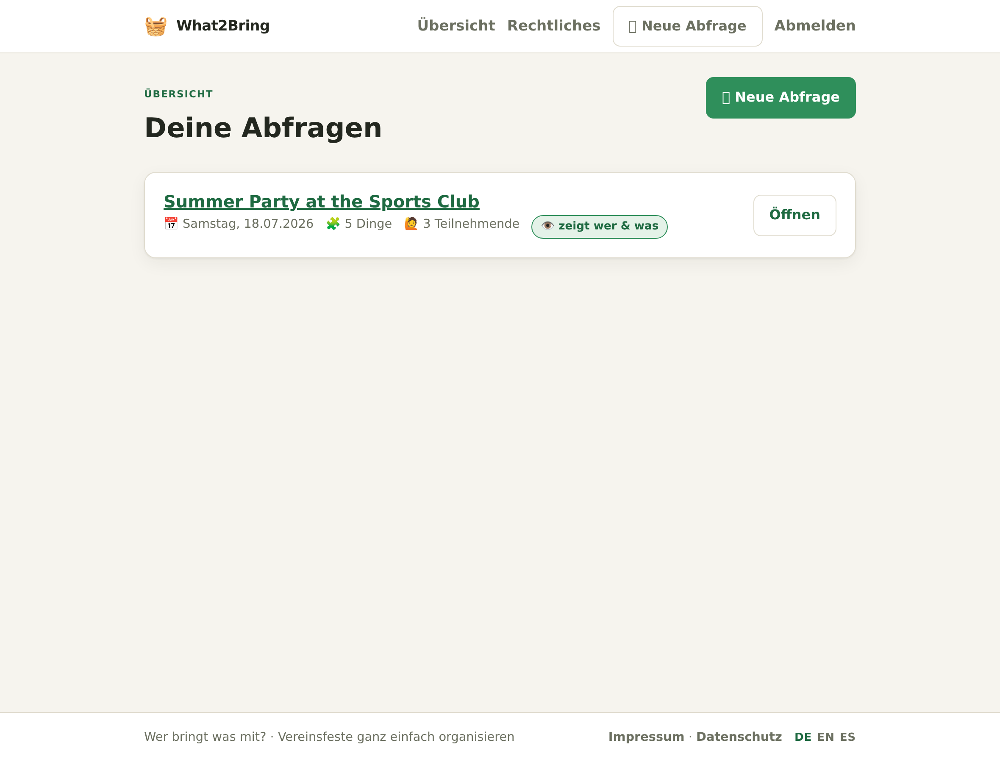 | 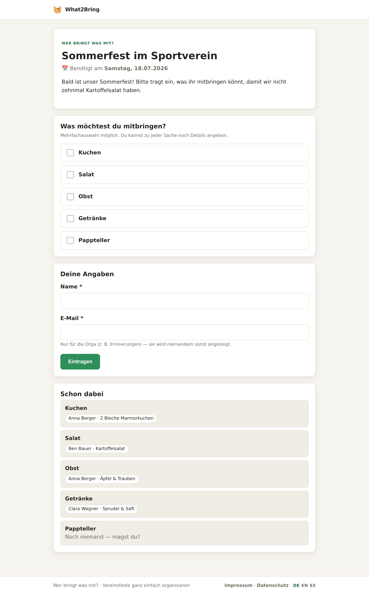 |

## Inhalt
1. [Voraussetzungen](#1-voraussetzungen)
2. [Installation](#2-installation)
   - [2.1 Docker (empfohlen)](#21-docker-empfohlen)
   - [2.2 Shared-Hosting / eigener Webserver](#22-shared-hosting--eigener-webserver)
   - [2.3 Der Einrichtungs-Assistent](#23-der-einrichtungs-assistent)
3. [Erste Anmeldung](#3-erste-anmeldung)
4. [Die Übersicht](#4-die-übersicht)
5. [Abfrage anlegen](#5-abfrage-anlegen)
6. [Abfrage verwalten & Link teilen](#6-abfrage-verwalten--link-teilen)
7. [Erinnerungen versenden](#7-erinnerungen-versenden)
8. [Die Teilnahmeseite](#8-die-teilnahmeseite)
9. [Impressum & Datenschutzerklärung](#9-impressum--datenschutzerklärung)
10. [Sprachen](#10-sprachen)
11. [Sicherheit & Datenschutz](#11-sicherheit--datenschutz)
12. [Konfigurationsreferenz](#12-konfigurationsreferenz)
13. [Reverse-Proxy & HTTPS](#13-reverse-proxy--https)
14. [Auf Shared-Hosting bereitstellen (z. B. Strato)](#14-auf-shared-hosting-bereitstellen-z-b-strato)
15. [Aktualisieren](#15-aktualisieren)
16. [Backup & Wiederherstellung](#16-backup--wiederherstellung)
17. [Fehlerbehebung](#17-fehlerbehebung)

---

## 1. Voraussetzungen
- **PHP 8.1+** mit den Erweiterungen **`pdo_sqlite`** und **`mbstring`** (im Docker-Image enthalten und bei den meisten
  Shared-Hostern aktiviert). Bei einer älteren PHP-Version zeigt What2Bring eine klare Meldung, statt zu starten.
- **Entweder** Docker (mit Compose) **oder** ein Webserver, der einen Ordner ausliefern kann: Apache (`.htaccess` liegt bei)
  oder nginx + PHP-FPM (Beispielkonfiguration liegt bei). Idealerweise zeigt das Document-Root der Domain auf den Ordner **`public/`**.
- **Kein** Datenbankserver, **kein** Composer, **kein** Build-Schritt. Der E-Mail-Versand nutzt einen winzigen eingebauten SMTP-Client.
- Für den Produktivbetrieb: **HTTPS** (z. B. über einen Reverse-Proxy oder den Hoster).

## 2. Installation

### 2.1 Docker (empfohlen)
Das Image ist produktionstauglich: Es läuft als unprivilegierter Benutzer `www-data` auf Port 8080 mit schreibgeschütztem
Root-Dateisystem, ohne Capabilities und mit `no-new-privileges`. Der gesamte Zustand (SQLite-Datenbank, `config.php`,
Mail-Log) liegt im Volume `/data`.

```bash
git clone https://github.com/Jo-Highness/what2bring.git && cd what2bring
docker compose up -d --build
docker compose logs what2bring        # zeigt das Setup-Token
```

1. Öffne **http://localhost:8470** (bzw. `http://<server>:8470`). Der Einrichtungs-Assistent erscheint.
2. Kopiere das **Setup-Token** aus `docker compose logs what2bring` (Block *„enter this setup token“*) in das erste Feld.
   Alternativ: `docker compose exec what2bring cat /data/.setup_token` — oder lege es vorab selbst per
   `W2B_SETUP_TOKEN` in der `docker-compose.yml` fest.
3. Fülle den Rest aus (siehe [2.3](#23-der-einrichtungs-assistent)) und klicke **Konfiguration erstellen** — sie wird
   nach `/data/config.php` im Volume geschrieben.
4. Melde dich an und lege deine erste Abfrage an. Für den echten Betrieb gehört HTTPS davor (siehe
   [13. Reverse-Proxy & HTTPS](#13-reverse-proxy--https)).

**Bind-Mount statt benanntem Volume?** Ersetze `w2b-data:/data` durch `./data:/data`. Das Verzeichnis muss für UID 33
(`www-data`) beschreibbar sein: einmalig `sudo chown -R 33:33 ./data` ausführen. Ist es das nicht, beendet sich der
Container mit genau diesem Hinweis. Alternativ den Container als root starten (`user: "0:0"` plus
`cap_add: [CHOWN, SETUID, SETGID]`); der Entrypoint korrigiert dann die Besitzrechte und wechselt selbst zu `www-data`.

**Konfiguration ohne Assistent:** `W2B_ADMIN_PASSWORD_HASH` und `W2B_APP_PEPPER` (plus `W2B_BASE_URL`, SMTP …) als
Umgebungsvariablen setzen — siehe [12. Konfigurationsreferenz](#12-konfigurationsreferenz). In der `docker-compose.yml`
muss jedes `$` des Passwort-Hashes als `$$` geschrieben werden. Geheimnisse können auch aus Dateien kommen
(`W2B_SMTP_PASS_FILE=/run/secrets/…`).

### 2.2 Shared-Hosting / eigener Webserver
1. **Code besorgen** — lade ein Release-Archiv herunter oder klone das Repository und lade es auf deinen Server hoch.
2. **Document-Root** — richte deine Domain auf das Verzeichnis **`public/`** aus. Alles Sensible (`config.php`, die
   Datenbank in `data/`, `inc/`, `templates/`) liegt dann *oberhalb* des Web-Roots. Wenn du das Document-Root nicht
   verschieben kannst (nur Apache), sperrt die mitgelieferte `.htaccess` auf oberster Ebene stattdessen den direkten Zugriff.
   Bei **nginx** gibt es keine `.htaccess` — dort **muss** das Document-Root `public/` sein; nutze
   [`docs/examples/nginx-php-fpm.conf`](examples/nginx-php-fpm.conf).
3. **`data/` beschreibbar machen** für den Webserver (dort entstehen Datenbank, Mail-Log und Setup-Token).
4. **Setup-Token holen:** Es wird beim ersten Aufruf ins PHP-Fehlerlog geschrieben und in `data/.setup_token` abgelegt —
   lade die Datei per FTP/SFTP herunter, wenn du das Log nicht lesen kannst. Alternativ `php bin/setup-token.php` auf dem Server.
5. **Öffne die Seite im Browser** und schließe den Assistenten ab.

Für einen schnellen lokalen Test: `W2B_SETUP_ALLOW_LOCAL=1 php -S 127.0.0.1:8080 -t public` — auf `127.0.0.1` fragt der
Assistent dann nicht nach dem Token. Diese Variable niemals hinter einem Reverse-Proxy auf demselben Rechner setzen.

### 2.3 Der Einrichtungs-Assistent
Solange die App nicht konfiguriert ist (keine `config.php` und keine Konfiguration per Umgebungsvariablen), zeigt jede
Seite den **Einrichtungs-Assistenten** (Installer):

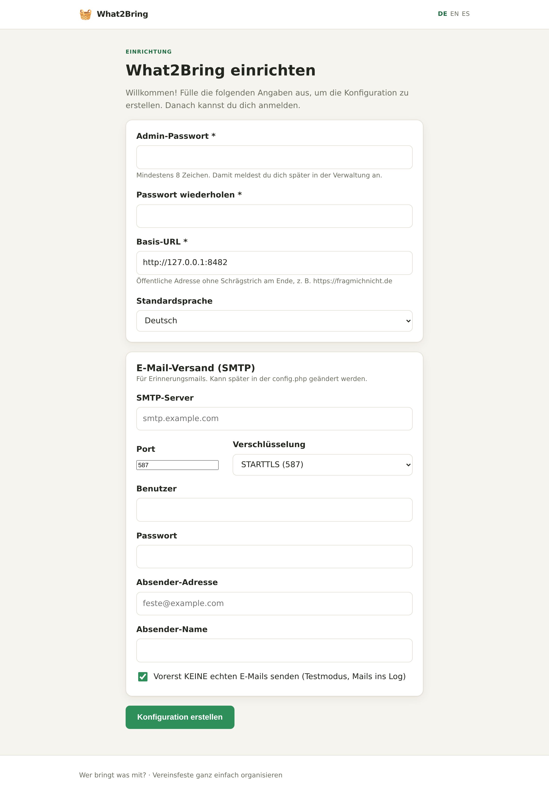

Trage ein:
- **Setup-Token** — belegt, dass du diesen Server betreibst (siehe oben). Ohne Token wird nichts gespeichert; so kann
  niemand eine frisch aufgesetzte Instanz vor dir übernehmen.
- **Admin-Passwort** (mind. 10 Zeichen) — damit meldest du dich an.
- **Basis-URL** — die öffentliche Adresse ohne abschließenden Schrägstrich, z. B. `https://feste.example.org`. Dient zum
  Bauen der teilbaren Links.
- **Vertrauenswürdige Reverse-Proxys** (optional) — siehe [13](#13-reverse-proxy--https).
- **Standardsprache** — DE / EN / ES.
- **SMTP** (jetzt optional, später änderbar) — Server, Port + Verschlüsselung (STARTTLS/587 oder SSL/465), Benutzer,
  Passwort, Absenderadresse und -name.
- **„Vorerst KEINE echten E-Mails senden"** — lass den Haken gesetzt, um in einem sicheren *Trockenlauf* zu starten
  (Erinnerungen landen in einer Log-Datei, statt versendet zu werden). Nimm den Haken weg, sobald deine SMTP-Daten stimmen.

Ein Klick auf **Konfiguration erstellen** schreibt `config.php` (mit frisch erzeugtem Passwort-Hash und geheimem
*Pepper*), löscht das Setup-Token, und der Installer **sperrt sich selbst** — er läuft nie wieder, solange die Konfiguration existiert.

> **Manuelle Alternative:** Kopiere `config.php.example` nach `config.php` (eine Ebene oberhalb von `public/` oder an den
> Pfad aus `W2B_CONFIG`) und fülle sie von Hand aus. Den Passwort-Hash erzeugst du mit
> `php -r "echo password_hash('DEIN-PW', PASSWORD_DEFAULT);"` und den Pepper mit `php -r "echo bin2hex(random_bytes(32));"`.

## 3. Erste Anmeldung
Rufe `…/index.php?r=admin.login` auf und gib dein Admin-Passwort ein.

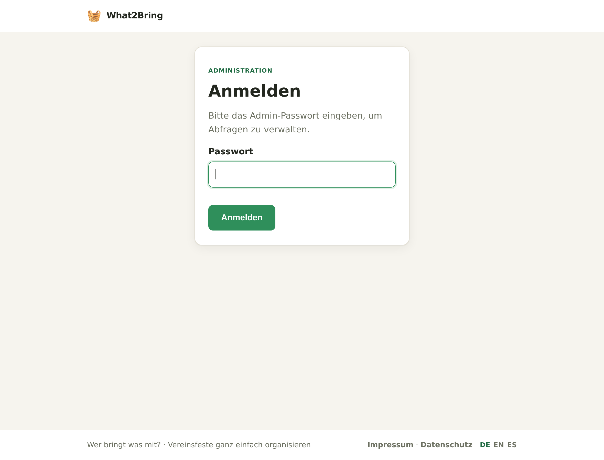

## 4. Die Übersicht
Nach der Anmeldung landest du in der **Übersicht** — der Liste aller deiner Abfragen mit Datum, Anzahl der Sachen, Anzahl der
Teilnehmenden und einem Sichtbarkeits-Abzeichen. Über **＋ Neue Abfrage** legst du eine an.


## 5. Abfrage anlegen
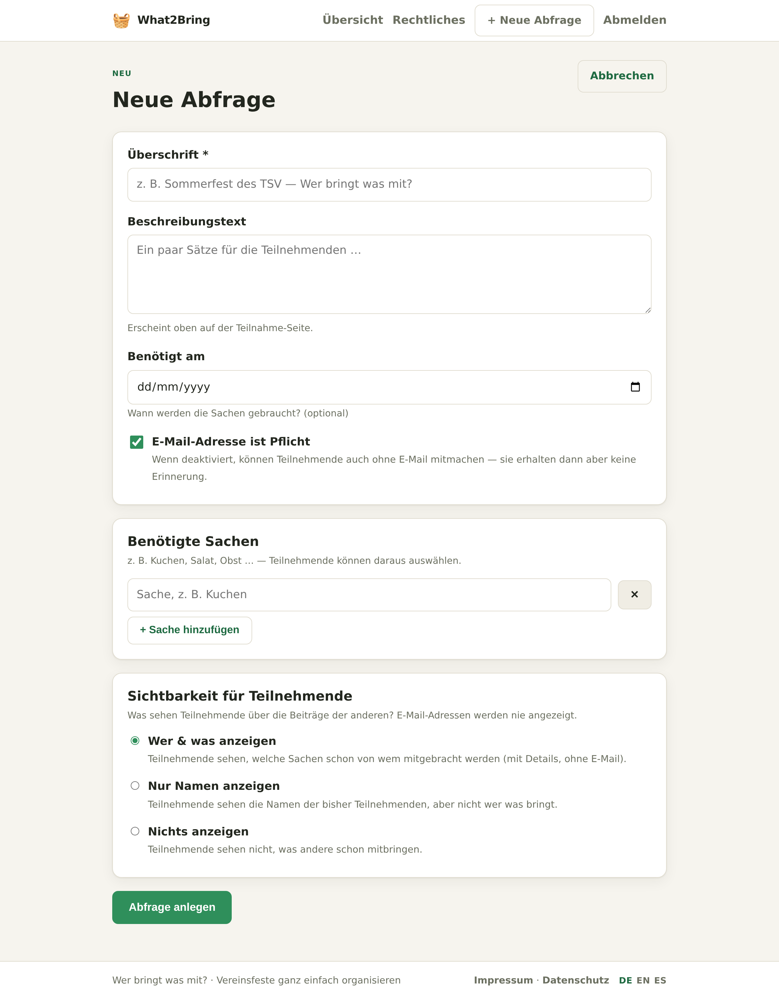

- **Überschrift** — der Titel, den die Teilnehmenden sehen (z. B. *„Sommerfest im Sportverein"*).
- **Beschreibung** — ein paar freundliche Sätze (optional).
- **Benötigt am** — das Datum, an dem die Sachen gebraucht werden (optional).
- **E-Mail-Adresse ist erforderlich** — ein Schalter je Abfrage. Ist er **aus**, können Leute *ohne* E-Mail-Adresse
  mitmachen (sie erhalten dann einfach keine Erinnerungen).
- **Benötigte Sachen** — füge so viele hinzu, wie du möchtest (Kuchen, Salat, Obst …). Die Teilnehmenden wählen daraus aus.
- **Sichtbarkeit für Teilnehmende** — was Leute über die Einträge *anderer* sehen. E-Mail-Adressen werden **nie** gezeigt:
  - **Wer & was anzeigen** — Namen + was sie mitbringen (mit Details).
  - **Nur Namen anzeigen** — nur, wer mitmacht.
  - **Nichts anzeigen** — Teilnehmende sehen die Einträge anderer nicht.

## 6. Abfrage verwalten & Link teilen
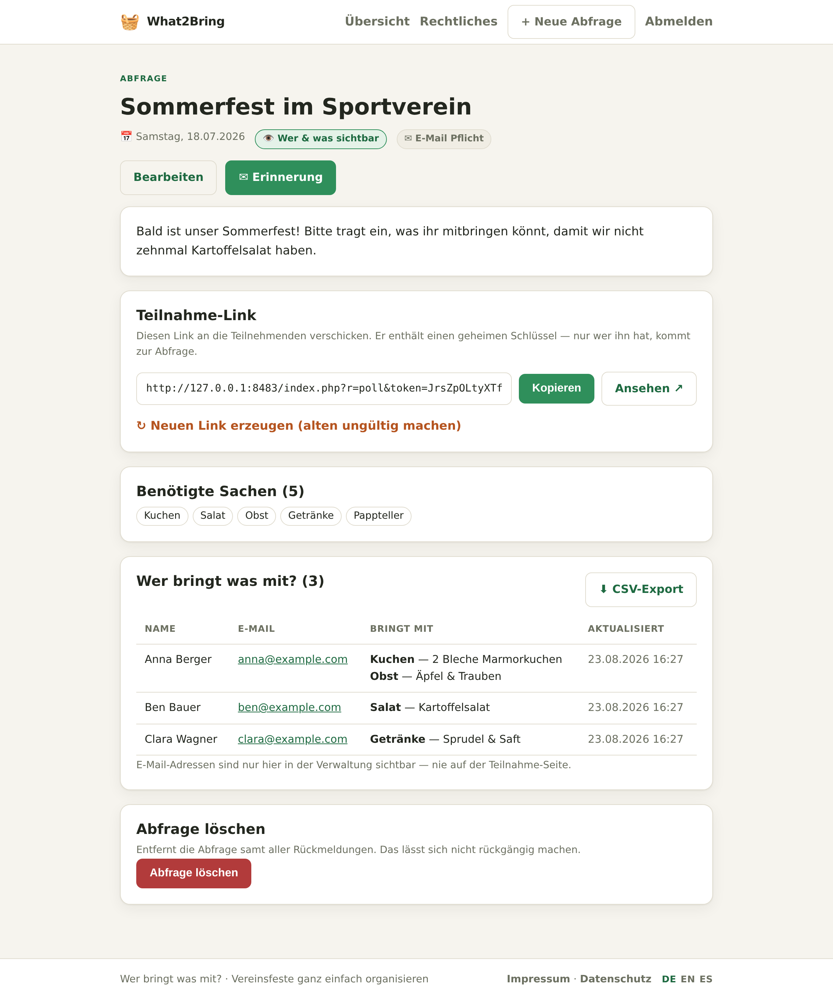

- **Teilnahme-Link** — die geheime URL zum Verschicken. Sie enthält einen zufälligen Schlüssel; nur wer den Link hat, erreicht die
  Abfrage (Suchmaschinen werden per `noindex` ausgesperrt). **Kopiere** ihn oder **öffne** ihn in einem neuen Tab.
- **Neuen Link erzeugen** — wechselt den Schlüssel. Der **alte Link funktioniert sofort nicht mehr** (praktisch, falls ein Link durchgesickert ist).
- **Benötigte Sachen** — ein schneller Überblick über die festgelegten Sachen.
- **Wer bringt was mit?** — jede Rückmeldung, **inklusive der E-Mail-Adresse** (nur für dich sichtbar, nie öffentlich).
  Einträge ohne E-Mail zeigen „— (keine E-Mail)".
- **CSV-Export** — lade alle Rückmeldungen (Name, E-Mail, bringt mit, Aktualisiert) als semikolon-getrennte UTF-8-Datei herunter, die
  sich sauber in Excel öffnet.
- **Einzelnen Eintrag löschen** — das ✕ neben einem Eintrag entfernt ihn (z. B. wenn jemand die Löschung seiner Daten verlangt).
- **Abfrage löschen** — entfernt die Abfrage und alle ihre Rückmeldungen (unwiderruflich).

## 7. Erinnerungen versenden
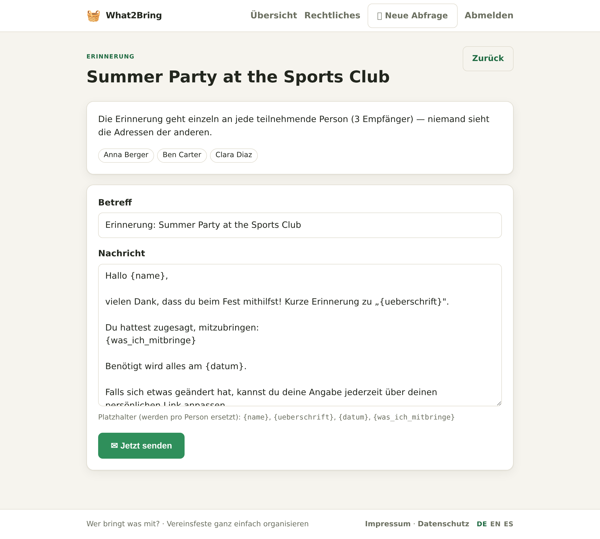

Schreibe einen Betreff und eine Nachricht und sende dann. Jede teilnehmende Person erhält eine **individuelle** E-Mail (ein Empfänger pro
Nachricht — niemand sieht die Adresse eines anderen). Diese Platzhalter werden pro Person ersetzt:

| Platzhalter | Wird zu |
|---|---|
| `{name}` | dem Namen der teilnehmenden Person |
| `{ueberschrift}` | der Überschrift der Abfrage |
| `{datum}` | dem „Benötigt am"-Datum |
| `{was_ich_mitbringe}` | dem, was diese Person mitzubringen zugesagt hat |

Kontaktiert werden nur Teilnehmende, die eine E-Mail angegeben haben. Das Nachrichtenfeld ist mit einer Vorlage in der aktuellen
Sprache vorbelegt — passe sie vor dem Senden nach Belieben an.

## 8. Die Teilnahmeseite
Das sehen Leute, wenn sie den geheimen Link öffnen. Sie haken die Sachen ab, die sie mitbringen, ergänzen optional ein
Detail pro Sache und tragen ihren Namen ein (und die E-Mail, falls erforderlich).

| Desktop | Mobil |
|---|---|
|  | 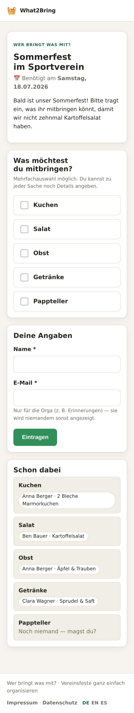 |

Je nach Sichtbarkeit der Abfrage sehen sie außerdem einen Bereich **„Wer ist dabei"** (Namen oder Namen + Sachen). Nach
dem Absenden erhalten sie eine Bestätigung mit ihrem **persönlichen Bearbeitungs-Link**:

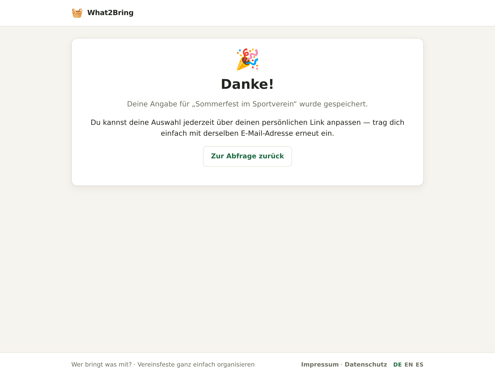

**Eintrag ändern oder zurückziehen:** Jeder Eintrag hat ein eigenes geheimes Bearbeitungs-Token. Der Browser, mit dem
der Eintrag angelegt wurde, merkt es sich (Cookie): Beim erneuten Öffnen des Abfrage-Links erscheint der eigene Eintrag
zum Ändern — oder zum Löschen über **Meinen Eintrag löschen**. Auf anderen Geräten nutzt man den persönlichen Link von
der Dankeseite (oder aus der optionalen Bestätigungsmail, `confirmation_mail`). Wer **ohne** dieses Token mit einer
**bereits verwendeten E-Mail-Adresse** absendet, bekommt eine klare Meldung — niemand kann fremde Einträge überschreiben,
nur weil er die Adresse kennt. Hat jemand seinen Link verloren, lösche den alten Eintrag in der Admin-Ansicht (✕ neben
dem Eintrag) und lass die Person sich neu eintragen.

Zum Schutz vor Spam gibt es Längenlimits (Name 100, E-Mail 254, Detail 200 Zeichen) und höchstens 20 Einträge pro
IP-Adresse und Abfrage innerhalb von 10 Minuten (`submit_rate_limit`).

## 9. Impressum & Datenschutzerklärung
Wenn du die Seite unter deiner eigenen Domain betreibst, brauchst du in der Regel ein **Impressum** und eine **Datenschutzerklärung**. What2Bring
macht beides **im Admin-Bereich editierbar** (Menü **Rechtliches**) — ohne Code-Änderungen, gespeichert in der Datenbank. Jedes Feld ist
mit einer Vorlage vorbelegt, die `[Platzhalter in Klammern]` enthält, die du ersetzt.

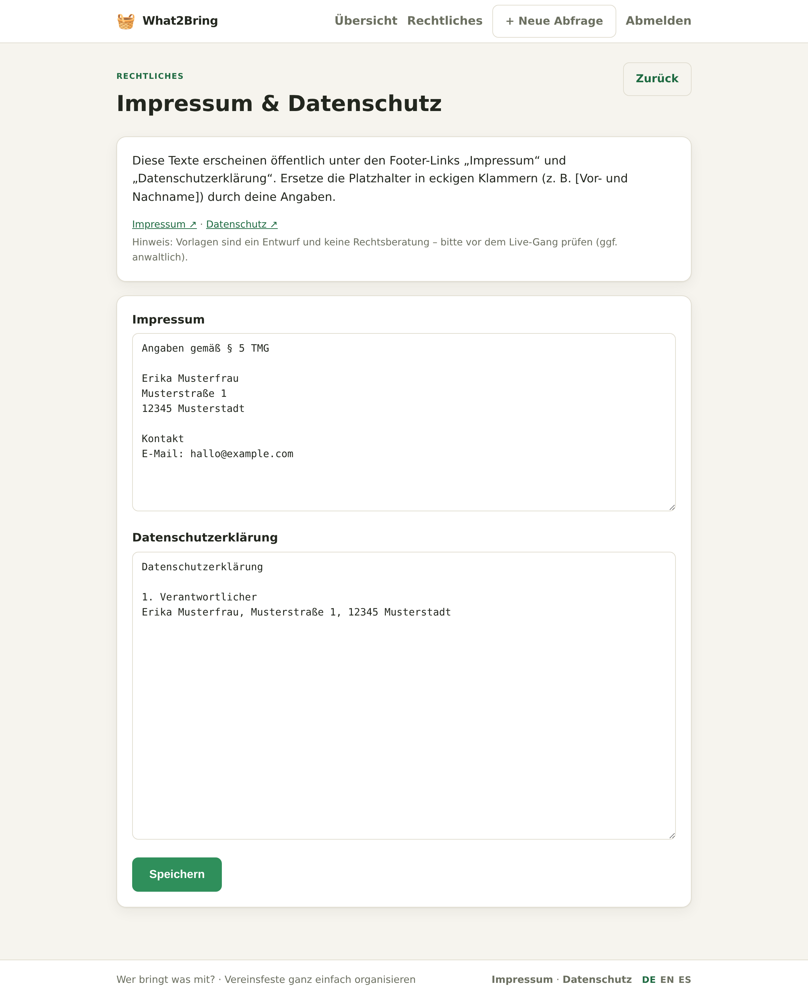

Die Texte werden öffentlich veröffentlicht und in der Fußzeile jeder Seite verlinkt:

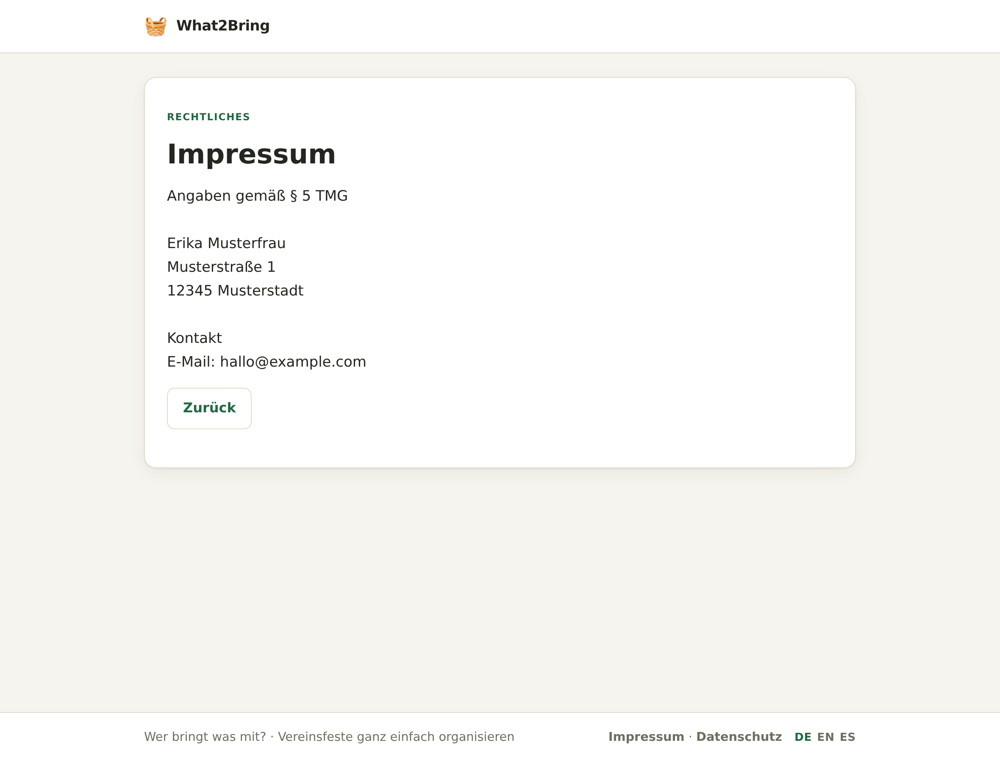

> ⚠️ Die Vorlagen sind ein **erster Entwurf, keine Rechtsberatung** — prüfe sie (und lass sie im Zweifel prüfen),
> bevor du live gehst.

## 10. Sprachen
What2Bring wird in **Deutsch, Englisch und Spanisch** ausgeliefert. Besucherinnen und Besucher schalten die Sprache über die Links
**DE · EN · ES** in der Fußzeile um; die Auswahl wird für ihre Sitzung gemerkt. Neue Besuchende bekommen die Sprache aus ihrem Browser,
ersatzweise die **Standardsprache**, die du bei der Einrichtung festgelegt hast (`default_lang` in `config.php`). Auch die Vorlagen für
Erinnerungs-E-Mails und die rechtlichen Texte sind lokalisiert.

## 11. Sicherheit & Datenschutz
- **E-Mail-Adressen gelangen nie an die Öffentlichkeit.** Klartext-Adressen liegen in einer *getrennten* Tabelle, die der
  öffentliche Code-Pfad nie liest — eine Teilnahmeseite kann die E-Mail einer Person also strukturell gar nicht anzeigen.
  (Nur wer das Bearbeitungs-Token eines Eintrags hat, sieht seine *eigene* Adresse, um sie zu ändern.)
- **Geheime Links** nutzen Zufalls-Tokens mit ≥128 Bit, sind `noindex` und können gewechselt werden. Bearbeitungs-Tokens
  haben 256 Bit und werden nur als Hash gespeichert.
- **Schutz des Installers:** Setup-Token erforderlich (siehe [2](#2-installation)).
- **Der Admin-Login** speichert nur einen Passwort-*Hash*. Fehlversuche werden in der Datenbank gezählt — pro IP (Sperre
  ab dem 5. Fehlversuch, ansteigend bis 15 Minuten) und für das Konto insgesamt (60 s Verzögerung nach 50 Fehlversuchen in
  15 Minuten); Cookies löschen hilft Angreifern also nicht. Sessions laufen im Strict Mode, erhalten nach dem Login eine
  neue ID und enden nach **30 Minuten Inaktivität** (`admin_idle_timeout`).
- **CSRF-Tokens** schützen jedes Formular; jeder Datenbankzugriff nutzt Prepared Statements; jede Ausgabe wird HTML-escaped.
- **Security-Header:** Content-Security-Policy ohne Inline-Skripte (`script-src 'self'`), HSTS bei HTTPS,
  `X-Frame-Options: DENY`, `nosniff`, `Referrer-Policy: no-referrer`, `noindex`.
- Erinnerungen werden **einzeln pro Empfänger** versendet (kein CC/BCC), mit gegen Injection gehärteten Mail-Headern;
  CSV-Exporte sind gegen Formel-Injection geschützt.

### Datenschutz (DSGVO)
- **Was gespeichert wird:** pro Eintrag Name, optional E-Mail-Adresse, gewählte Sachen/Details und Zeitstempel. Für die
  Drosselung werden IP-Adressen nur als verschlüsselter Hash (HMAC) gespeichert und nach 24 Stunden gelöscht. Kein
  Tracking, keine externen Ressourcen.
- **Löschen:** In der Admin-Ansicht eine ganze Abfrage (samt aller Einträge) oder einen einzelnen Eintrag löschen;
  Teilnehmende können ihren eigenen Eintrag löschen. Automatische Löschung mit `purge_after_days` (z. B. `90`):
  Abfragen werden so viele Tage nach ihrem Datum (bzw. nach dem Anlegen, wenn sie kein Datum haben) entfernt — geprüft
  beim Öffnen der Übersicht oder täglich per `php bin/purge.php` (Cron, siehe
  [`docs/examples/crontab.example`](examples/crontab.example)).
- **Mail-Log im Trockenlauf:** Im Trockenlauf landen Erinnerungen in `mail.log` neben der Datenbank. Standardmäßig wird
  die Empfängeradresse maskiert (`mail_log` = `redacted`); `full` protokolliert alles (personenbezogene Daten!), `off`
  gar nichts. Die Datei regelmäßig löschen oder rotieren — siehe [`docs/examples/logrotate-what2bring`](examples/logrotate-what2bring).
- **SMTP-Anbieter:** Beim echten Versand verarbeitet dein Mail-Anbieter die Empfängeradressen in deinem Auftrag. Schließe
  mit ihm einen **Auftragsverarbeitungsvertrag (AVV, Art. 28 DSGVO)** und nenne ihn in deiner Datenschutzerklärung.
- Auch Backups enthalten personenbezogene Daten — geschützt aufbewahren und alte Stände löschen.

## 12. Konfigurationsreferenz
Einstellungen kommen aus `config.php` (vom Assistenten geschrieben; siehe `config.php.example`) und/oder aus
Umgebungsvariablen. **Umgebungsvariablen haben Vorrang.** Zu jeder Variable kann `NAME_FILE` auf eine Datei mit dem Wert
zeigen (Docker-Secrets).

| Schlüssel in config.php | Umgebungsvariable | Standard | Bedeutung |
|---|---|---|---|
| — | `W2B_CONFIG` | `<app>/config.php` (Docker: `/data/config.php`) | Ort der Konfigurationsdatei |
| — | `W2B_DATA_DIR` | `<app>/data` (Docker: `/data`) | Datenbank, Mail-Log, Setup-Token |
| — | `W2B_SETUP_TOKEN` | erzeugt | Festes Setup-Token für den Assistenten |
| — | `W2B_SETUP_ALLOW_LOCAL` | aus | Assistent ohne Token auf 127.0.0.1/::1 |
| `admin_password_hash` | `W2B_ADMIN_PASSWORD_HASH` | — | `password_hash()` des Admin-Passworts |
| `app_pepper` | `W2B_APP_PEPPER` | — | Geheimer Schlüssel (64 Hex-Zeichen); nicht mehr ändern |
| `base_url` | `W2B_BASE_URL` | — | Öffentliche URL ohne abschließenden Schrägstrich |
| `default_lang` | `W2B_DEFAULT_LANG` | `de` | `de`, `en` oder `es` |
| `db_file` | `W2B_DB_FILE` | `<Datenverzeichnis>/what2bring.sqlite` | SQLite-Datei (außerhalb des Document-Roots!) |
| `mail_dry_run` | `W2B_MAIL_DRY_RUN` | `true` | Erinnerungen protokollieren statt senden |
| `mail_log` | `W2B_MAIL_LOG` | `redacted` | Trockenlauf-Log: `redacted`, `full`, `off` |
| `trusted_proxies` | `W2B_TRUSTED_PROXIES` | keine | IPs/CIDRs, die `X-Forwarded-*` setzen dürfen (in der Variable kommagetrennt) |
| `hsts` | `W2B_HSTS` | `true` | HSTS bei HTTPS-Anfragen senden |
| `admin_idle_timeout` | `W2B_ADMIN_IDLE_TIMEOUT` | `1800` | Sekunden bis zur Abmeldung bei Inaktivität |
| `purge_after_days` | `W2B_PURGE_AFTER_DAYS` | `0` (aus) | Abfragen N Tage nach ihrem Datum löschen |
| `submit_rate_limit` | `W2B_SUBMIT_RATE_LIMIT` | `20` | Einträge pro IP und Abfrage je 10 min (0 = unbegrenzt) |
| `confirmation_mail` | `W2B_CONFIRMATION_MAIL` | `false` | Teilnehmenden ihren Bearbeitungs-Link mailen |
| `smtp.host` / `port` / `secure` | `W2B_SMTP_HOST` / `_PORT` / `_SECURE` | — / `587` / `starttls` | `secure`: `starttls`, `ssl` oder `none` |
| `smtp.user` / `pass` | `W2B_SMTP_USER` / `W2B_SMTP_PASS` | — | SMTP-Anmeldung |
| `smtp.from_email` / `from_name` | `W2B_SMTP_FROM_EMAIL` / `_FROM_NAME` | — | Absender |
| `smtp.verify_tls` | `W2B_SMTP_VERIFY_TLS` | `true` | Zertifikat des SMTP-Servers prüfen |

## 13. Reverse-Proxy & HTTPS
Betreibe What2Bring produktiv nur über HTTPS — Admin-Passwort, geheime Links und personenbezogene Daten gehen über die
Leitung. Üblich ist ein Reverse-Proxy (nginx, Caddy, Traefik, Apache), der TLS terminiert und an den Container auf
`127.0.0.1:8470` weiterleitet.

- **Sag What2Bring, welchem Proxy es vertrauen soll.** Nur dann werden `X-Forwarded-Proto` (→ sichere Cookies, HSTS) und
  `X-Forwarded-For` (→ richtige Client-IP für die Drosselung) übernommen: `trusted_proxies` / `W2B_TRUSTED_PROXIES` auf
  die Adresse setzen, mit der die App den Proxy sieht (Docker-Host: meist das Bridge-Gateway wie `172.17.0.1`, oder
  `172.16.0.0/12`). Header von allen anderen werden ignoriert — Clients können sie also nicht fälschen.
- Der Proxy muss `X-Forwarded-For` mit der Client-Adresse **überschreiben** (nicht vom Client gelieferte Werte anhängen)
  und `X-Forwarded-Proto` setzen.
- Die **Basis-URL** auf die `https://`-Adresse setzen.
- Den Container-Port nur auf localhost veröffentlichen (`"127.0.0.1:8470:8080"` in der `docker-compose.yml`).

Beispiel für nginx: [`docs/examples/nginx-reverse-proxy.conf`](examples/nginx-reverse-proxy.conf):

```nginx
location / {
    proxy_pass http://127.0.0.1:8470;
    proxy_set_header Host              $host;
    proxy_set_header X-Forwarded-For   $remote_addr;
    proxy_set_header X-Forwarded-Proto $scheme;
}
```

Ohne Container liefert nginx + PHP-FPM die App direkt aus — Document-Root `public/`, alles andere gesperrt:
[`docs/examples/nginx-php-fpm.conf`](examples/nginx-php-fpm.conf).

## 14. Auf Shared-Hosting bereitstellen (z. B. Strato)
- Zeige das **Document-Root der Domain am besten auf `public/`**. Ist das nicht möglich, verweigert die mitgelieferte
  `.htaccess` auf oberster Ebene den Web-Zugriff auf `inc/`, `data/`, `templates/`, `bin/`, `config.php` und `schema.sql`.
- `config.php` und das Verzeichnis `data/` müssen **oberhalb** des Document-Roots liegen (oder per `.htaccess` gesperrt sein).
- Das Routing ist **query-basiert** (`index.php?r=…`), daher ist `mod_rewrite` **nicht** erforderlich.
- Mache `data/` für den Webserver **beschreibbar** — die SQLite-Datenbank wird beim ersten Zugriff automatisch angelegt.
- Wähle im Hosting-Kundenmenü **PHP 8.1 oder neuer**.
- Aktiviere HTTPS (die meisten Hoster bieten kostenlose Let’s-Encrypt-Zertifikate) und nutze die `https://`-Basis-URL.
- Trage die SMTP-Daten ein und nimm den Haken beim Trockenlauf weg (oder setze `mail_dry_run` auf `false`), sobald du zum
  echten Versand bereit bist.

## 15. Aktualisieren
Lies zuerst das [CHANGELOG](../CHANGELOG.md) — besonders den Abschnitt *Changed*. Datenbank-Migrationen laufen beim ersten
Aufruf nach dem Update automatisch; `config.php` bleibt unverändert (neue Einstellungen haben sichere Standardwerte).

**Docker:**
```bash
docker compose exec what2bring php bin/backup.php   # Snapshot ins Volume
git pull
docker compose up -d --build
```

**Shared-Hosting / eigener Server:** Backup machen (Abschnitt 16), dann die neuen Dateien hochladen — **außer**
`config.php` und `data/` (alles andere ersetzen, auch `inc/`, `templates/` und `public/`).

### Upgrade auf 1.6.0
- **Admins werden einmalig abgemeldet** (das Session-Cookie wurde umbenannt). Bestehende Einträge bleiben erhalten;
  Teilnehmende können sie aber erst nach einem neuen Eintrag selbst bearbeiten, weil ältere Einträge kein
  Bearbeitungs-Token haben — der Admin kann den alten Eintrag löschen, die Person trägt sich neu ein.
- **Docker-Nutzer des alten Test-Setups** (Bind-Mounts `./config.php` und `./data`, Container-Port 80):
  1. `docker compose down`, dann die Konfiguration ins Datenverzeichnis verschieben: `mv config.php data/config.php`.
  2. Die neue `docker-compose.yml` mit dem Bind-Mount `./data:/data` statt des benannten Volumes nutzen und
     `sudo chown -R 33:33 ./data` ausführen. Der `db_file`-Pfad aus der alten Konfiguration wird im Image durch
     `W2B_DB_FILE=/data/what2bring.sqlite` überschrieben, die bestehende Datenbank wird also weiterverwendet.
  3. `docker compose up -d --build`. Der Host-Port bleibt 8470.
- Das Mail-Log im Trockenlauf maskiert jetzt Empfängeradressen (`mail_log`); für das alte Verhalten `'mail_log' => 'full'` setzen.

## 16. Backup & Wiederherstellung
Alle Daten liegen in der SQLite-Datenbank (standardmäßig `data/what2bring.sqlite`). Sie läuft im **WAL-Modus**: Jüngste
Änderungen können noch in `what2bring.sqlite-wal` stehen. **Nur die `.sqlite`-Datei zu kopieren kann Daten verlieren.**
Nutze eine dieser Varianten:

- **Eingebaut:** `php bin/backup.php` schreibt einen konsistenten Snapshot nach `data/backups/what2bring-<Datum>.sqlite`
  (Docker: `docker compose exec what2bring php bin/backup.php`, die Datei landet im Volume unter `/data/backups/`).
  Optional ein Zielpfad als Argument. Cron-geeignet, siehe [`docs/examples/crontab.example`](examples/crontab.example).
- **sqlite3-CLI:** `sqlite3 data/what2bring.sqlite ".backup 'backup.sqlite'"`.
- **Dateikopie:** nur bei gestoppter App, und immer `what2bring.sqlite`, `-wal` und `-shm` gemeinsam kopieren.

Sichere außerdem `config.php` — der `app_pepper` darin wird gebraucht, um bestehende E-Mail-Adressen wiederzuerkennen.

**Wiederherstellen:** App (bzw. Container) stoppen, `what2bring.sqlite` durch das Backup ersetzen, vorhandene
`what2bring.sqlite-wal` / `-shm` **löschen**, wieder starten. Beim benannten Docker-Volume (`<Projekt>_w2b-data`,
z. B. `what2bring_w2b-data`) mit einem kurzlebigen Hilfscontainer:

```bash
docker compose stop
docker run --rm -v what2bring_w2b-data:/data -v "$PWD":/b alpine sh -c \
  'cp /b/backup.sqlite /data/what2bring.sqlite && rm -f /data/what2bring.sqlite-wal /data/what2bring.sqlite-shm && chown 33:33 /data/what2bring.sqlite'
docker compose start
```

## 17. Fehlerbehebung
| Symptom | Wahrscheinliche Ursache / Abhilfe |
|---|---|
| Browser zeigt unerwartet den **Einrichtungs-Assistenten** | Keine Konfiguration gefunden: `config.php` fehlt / liegt nicht eine Ebene oberhalb von `public/`, oder `W2B_CONFIG` zeigt woandershin. |
| Assistent meldet **„Setup-Token ist falsch“** | Token aus dem Log oder aus `data/.setup_token` verwenden (Docker: `docker compose exec what2bring cat /data/.setup_token`). `W2B_SETUP_TOKEN` hat Vorrang vor der Datei. |
| Assistent: **Setup-Token konnte nicht angelegt** / **config.php nicht geschrieben werden** | Datenverzeichnis bzw. Konfigurationsort ist für den Webserver-Benutzer nicht beschreibbar (Docker: UID 33 → `chown -R 33:33 ./data`). |
| Container beendet sich mit **„data directory … is not writable“** | Bind-Mount gehört root — `sudo chown -R 33:33 ./data` oder das benannte Volume verwenden. |
| Meldung **„benötigt PHP 8.1“** | Im Hosting-Kundenmenü eine neuere PHP-Version wählen. |
| Teilnahme-Link zeigt **„Nicht gefunden"** | Falsches oder gewechseltes Token — *Neuen Link erzeugen* macht alte Links ungültig. |
| Teilnehmende: **„Mit dieser E-Mail-Adresse gibt es schon einen Eintrag“** | Die Person hat sich schon auf einem anderen Gerät/Browser eingetragen. Persönlichen Link nutzen oder den alten Eintrag in der Admin-Ansicht löschen. |
| **„Zu viele Fehlversuche“** beim Login | Angezeigte Zeit abwarten. Hinter einem Reverse-Proxy `trusted_proxies` prüfen — sonst teilen sich alle die IP des Proxys. |
| Nach einer Weile abgemeldet | Inaktivitäts-Timeout (`admin_idle_timeout`, Standard 30 min). |
| **Erinnerungen kommen nicht an** | Prüfe `mail_dry_run` (Trockenlauf schreibt nach `mail.log` neben der Datenbank); prüfe SMTP-Host/-Port/-Verschlüsselung und dass der Absender zum authentifizierten Postfach passt. |
| Links zeigen hinter HTTPS auf `http://` | `https://`-Basis-URL eintragen und `trusted_proxies` konfigurieren. |
| Wochentag/Datum in falscher Sprache | Die Sprache folgt dem Umschalter in der Fußzeile / `default_lang`. |

---

*What2Bring — Vereinsfeste ganz einfach organisieren.*
